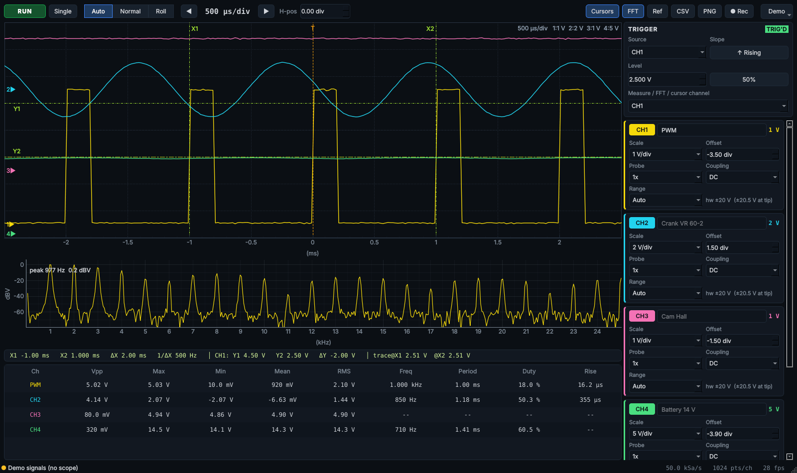

# Scope1008

A replacement front end for the Hantek 1008A / 1008B / 1008C 8‑channel USB scope.
Fast pyqtgraph display, real triggering, cursors, auto measurements, FFT, a roll/data‑logger
mode that streams to CSV, and settings that persist between sessions.



It talks to the scope directly over USB using the protocol reverse‑engineered by
[mfg92/hantek1008py](https://github.com/mfg92/hantek1008py) (Apache‑2.0, vendored in
`scope1008/hantek1008.py` with small fixes). Hantek's DLL and software are not used.

## Install

Install Python 3.12 or newer from python.org, then just run the launcher:

* Windows: double-click `run.bat` (or `run_demo.bat` to try it without the scope)
* Linux: `./run.sh` (or `./run.sh --demo`)

The first launch creates a private `.venv` folder and installs the exact package versions in
`requirements.lock`. Every download is checked against a SHA-256 hash, so a tampered package
won't install. Later launches skip this step unless the lock file changes. Nothing is installed
into your system Python.

Manual setup, if you prefer: `python tools/bootstrap.py`, then `.venv\Scripts\python -m scope1008`.
For development, `python tools/bootstrap.py --dev` adds pytest, ruff and pip-audit.

Try it without the scope first: `run_demo.bat` (or `run.sh --demo`). The demo feeds
automotive-ish test signals (PWM, 60‑2 crank VR, cam hall, charging ripple, O2, TPS, UART).

### Windows: give the scope a WinUSB driver (one time)

Hantek's own driver hides the scope from libusb, so you need to swap it:

1. Plug in the 1008B and download **Zadig** (zadig.akeo.ie).
2. Options → *List All Devices*. Pick the Hantek entry with USB ID **0783 5725**.
3. Target driver **WinUSB** → *Replace Driver*.
4. Run `run.bat`.

This makes Hantek's software stop seeing the scope. To go back: Device Manager → the device →
*Uninstall device* (tick "delete the driver"), replug, and reinstall Hantek's driver.

### Linux

```
echo 'ACTION=="add", SUBSYSTEM=="usb", ATTRS{idVendor}=="0783", ATTR{idProduct}=="5725", MODE="0666"' \
  | sudo tee /etc/udev/rules.d/99-hantek1008.rules
sudo udevadm control -R    # then replug
./run.sh
```

## Using it

**Leave the inputs disconnected when it starts.** Startup measures the zero offset of every
channel on every range. If a probe is on a live signal you get a DC offset error;
*Device → Recalibrate zero* redoes it at any time.

* **Channels (right panel):** click CH1…CH8 or press 1–8. Scale, offset (in divisions), probe
  factor (1x/10x/20x/100x; the HT201 attenuator is 20x), DC/AC coupling.
* **Range = Auto** picks the most sensitive of the three hardware ranges (±20 V, ±2.5 V, ±0.4 V)
  that still covers the whole screen at your scale and offset, so you get the best resolution
  without thinking about it. A red **CLIP** tag means the ADC saturated.
* **Trigger:** source, slope, level. Drag the dashed line on the plot or hit **50%**.
  *Auto* free-runs if there is no edge, *Normal* waits, *Single* grabs one frame and stops.
  Triggering is done in software on the captured record with hysteresis and sub-sample
  interpolation, so the display is stable even though the hardware trigger is basic.
* **Roll:** continuous strip chart from 50 ms/div to 60 s/div. **● Rec** streams every sample to
  CSV for as long as you want (data logger use).
* **Cursors, FFT, measurements** all follow the *Measure / FFT / cursor channel*.
* **Ref** freezes the current traces as a dim overlay for before/after comparisons;
  right-click Ref to clear.
* **CSV / PNG** export what is on screen.

| Key | Action |
|---|---|
| Space | Run / Stop |
| S | Single |
| ← / → or mouse wheel on plot | Timebase |
| ↑ / ↓ | V/div of the measure channel |
| 1–8 | Toggle channel |
| C / F / R / T | Cursors / FFT / Ref / Trigger slope |
| Ctrl+S / Ctrl+P | Export CSV / PNG |

`python -m scope1008 --debug` logs USB traffic, `--reset` forgets saved settings.

## Known limits

* The protocol reverse engineering is partial and was done on a single 1008C. Roll mode is the
  best-tested path in the original driver. Burst (triggered) mode should work but is less proven.
* Burst timebase assumes about 25 samples/div (from the driver notes). Sanity check the time axis
  once against a known frequency; if it is off, change `SAMPLES_PER_DIV` in `scope1008/backend.py`.
* If your unit reports a different USB product id, set `SCOPE1008_PID=xxxx` before launching
  (the error message tells you the id it found).
* The 8 digital outputs (waveform generator) are not exposed yet.
